## Lecture 01.1:

### Bilan Energetique

**What is a monsoon:**  
Seasonal reversal of wind

**In terms of latitude where is there lots and where is there few rain:**  
Lots = ITCZ  
Few = Au bord des tropiques 30 °N

**Storms tracks are principally during what time of year:**  
Winter

**Where is sea surface salinity high and why:**  
Tropical areas  
More evaporation

**What are the atmosphere layers and how does temp change:**  
Troposphere = Dec  
Stratosphere = Inc  
Mesosphere = Dec  
Thermosphere = Inc

**What is lapse rate:**  
How temp changes with height in atmosphere

**When is the atmosphere unstable:**  
When the parcel of air is warmer than the surrounding atmosphere

**What happens to water in the air after the dew point is reached:**  
Condensation

**Why does temperature increase with height in the stratosphere:**  
Ozone absorbs UV

**Why does temp increase with height in the thermosphere:**  
O2 absorbs UV

**How does ozone form in the stratosphere (2):**  
\- UV splits O2  
\- Single O joins up with another O2 making O3

**How is ozone depleted in the stratosphere (3):**  
\- Chlorine from CFC takes away an oxygen from O3  
\- Another oxygen takes away oxygen from ClO  
\- Now we have a new free Cl and an O2

**Where is the ozone depletion the worst:**  
Antarctica (PSC)

**What are PSC made from:**  
Condensed water and nitric acid (HNO3)

**Why do PSC increase ozone destruction (2):**  
\- Gives a surface for a reaction to occur that creates Cl2  
\- Breaking down reservoir species  
PSC take HNO3 out of stratosphere meaning ClO is not put into reservoir species

**What is the equinox:**  
When earth axis is not tilted towards or away from the sun  
12 hour day 12 hour night

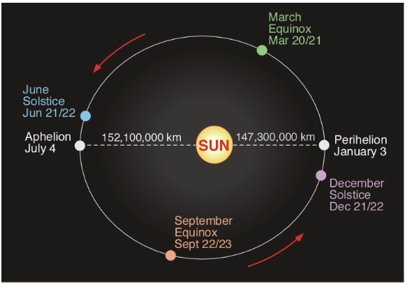

**What are the solstices:**  
When earth is max titled towards or away sun

**In NH summer what latitude is perpendicular to the sun:**  
23.5 °N

**What is the name of 23.5 °N latitude line:**  
Tropic of cancer

**What are the 3 positions below the horizon the sun can be in:**  
Civil = 0-6°  
Nautical = 6-12°  
Astronomical 12-18°

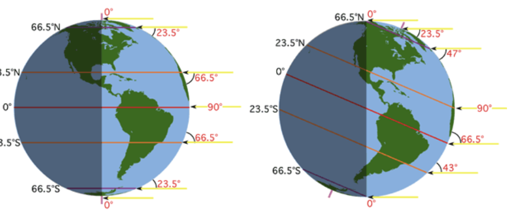

**Why is twilight longer at higher latitudes:**  
The suns course is titled at shallow and oblique angle relative to horizon  
This mean it takes long for the sun to pass through the twilight zones

**What is a blackbody:**  
Theoretical object that absorbs all incoming rad  
(None passes through none reflected)  
And re-emits the max amount of energy for its temperature

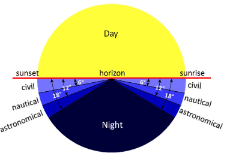

**A black body re-emits at what wavelength:**  
All of them

**What is a grey body (2):**  
Has emissivity > 1  
But re-emits at all wavelength

**What is a selective radiator:**  
Absorbs and re-emits only certain wavelengths

**What is Kirchhoff law:**  
When in equilibrium / at constant temp, the amount absorbed and emitted is equal  
Absorption = Emissivity  
A poor absorber is a poor emitter

**What is emissivity:**  
Simply the amount of energy a body emits  
Relative to a black body which emits all energy at all wavelengths, remember most bodies only emit at some wavelength  
If emissivity increases, the body must have gained some energy source in some way

**What is the Stefan-Boltzmann law:**  
F = εσT4  
Energy flux is proportion to Emissivity, Constant, and Temperature

**What is Wien's displacement law:**  
λmax = b / T  
The wavelength radiated the most is equal to Constant / Temp  
Hotter object = emits shorter wavelength

**What is the solar constant:**  
1366 W/m^2

**How do you derive the solar constant:**  
\- Find flux of sun energy with Stefan-Botzmann  
\- Multiply by area of sun to get total watts (not W/m2)  
\- Assume blackbody  
\- Find how much energy actually hits earth from spherical sun (f)  
\- rse is radius sun to earth  
\- Multiply this fraction by the total, then divide by earth surface area to get watts per m2

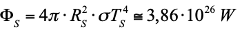

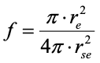

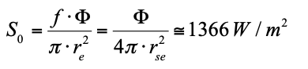

**An albedo of 0.3 means what:**  
30% is reflected

**This equation is the simplest form to find earth surface temperature,**  
**Why is it that energy IN is multiplied by πR2 while energy OUT is multiplied by 4πR2:**  
πR2 cause sun energy only hits cross section of earth (area of circle)  
4πR2 cause earth radiates out in all directions as a sphere (area of sphere)

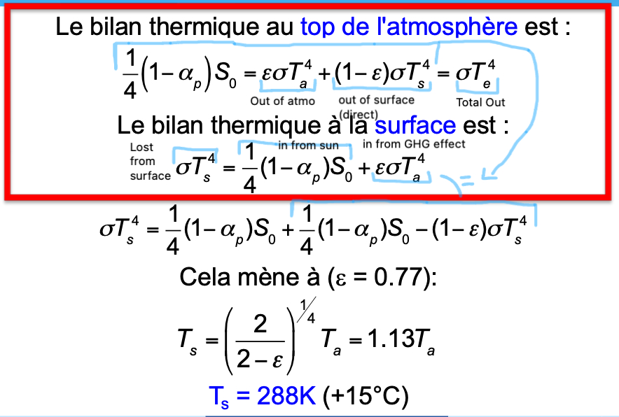

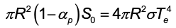

**The atmospheric window is between what λ:**  
8-12 μm

**1 ppm is equal to what percent:**  
0.0001%

**A gas would have the highest global warming potential if:**  
It absorbs energy in the atmospheric window  
(Also has long resident time)

**Total energy into earth equals:**  
(1 - albedo) \* (solar constant / 4)

**In the no atmosphere problem, total energy out of earth equals:**  
σ\* Temp earth ^4

**Without GHG effect what is earth temp:**  
-18

**If we consider the atmosphere as a 1 layer blackbody, transparent to sunlight but opaque to IR,**  
**what surface temp do we get and why is it so wrong:**  
+30 we assumed black body —> we did not consider emissivity for earth and the atmosphere  
(earth and atmo does not emit like a blackbody meaning less energy in the system)

**In the 1 atmospheric layer problem,**  
**energy out of TOA and energy escaping from surface equals:**  
TOA = Stephan Boltzam  
ε\* σ\* T atmosphere ^4  
Surface = Stephan Boltzam with 1-ε  
(1 - ε) \* σ\* T atmosphere ^4  
Total = ε\* σ\* T earth ^4

**In the 1 atmospheric layer problem, why is energy leaving directly from surface have the 1-εterm:**  
Represents the energy that is not absorbed by the atmosphere layer  
Leftover energy that made it through the layer

**In the 1 atmospheric layer problem, what is the energy balance equation:**  
In = (1 - albedo) \* (solar constant / 4) + ε\* σ\* T atmosphere ^4  
Out = ε\* σ\* T earth ^4

**In the 1 atmospheric layer problem, How do you solve for Temp Earth:**  
Create 1 equation for TAO balance and 1 for Earth Balance  
Solve TOA for Temp Atmo then solve Earth

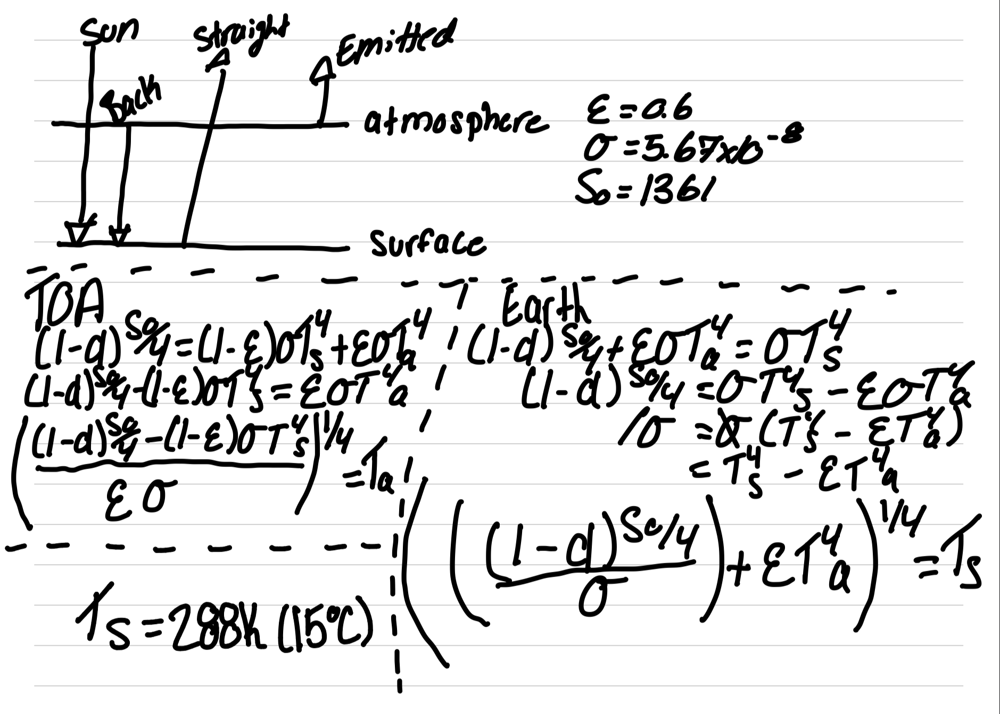

**When we consider emissivity and the GHG effect what average temp do we get for earth:**  
15°C

**What is the emissivity of earth:**  
About 0.77

**If we add more hypothetical layers to the atmosphere what happens to temp:**  
Increase  
More GHG effect

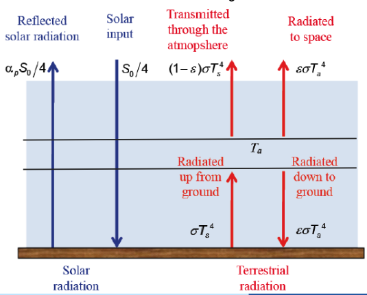

**What is the formula for effective radiating level:**  
(temp surface - 255) / lapse rate  
255 = effective emission temp

## Lecture 01.2:

### Bilan Energetique 2

**What is OLR:**  
Outgoing Longwave Radiation

**What are the 3 inputs to OLR in a 2 atmospheric layer system**  
**and how do you calculate each:**  
\- Energy radiated from the top of the atmosphere (layer 2)  
εσT₂⁴  
\- Energy from L1 that makes it through L2  
(1−ε)εσT₁⁴  
(Layer 1 emits εσT₁⁴, and a fraction (1−ε) of it passes through layer 2 unabsorbed)  
\- Energy that makes it through both layers  
(1−ε)²σT₀⁴  
(The surface emits as a blackbody (σT₀⁴), and a fraction (1−ε) passes through each layer)  
OLR = εσT₂⁴ + (1−ε)εσT₁⁴ + (1−ε)²σT₀⁴

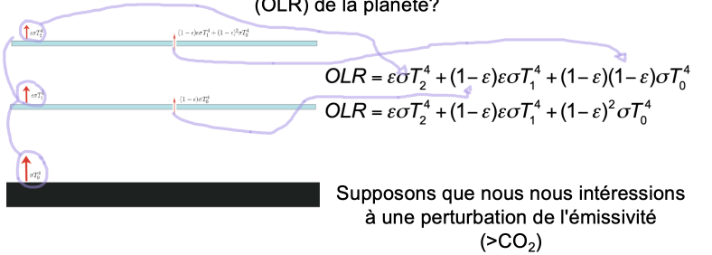

**What do we do to the OLR equation to find the effects of changing emissivity on OLR:**  
Take derivative

**How do you take the derivative of the OLR equation:**  
\- First term remove ε  
\- Second term add 2 to ε, remove ε outside bracket  
\- Third term exponent rule the bracket and switch to ε-1

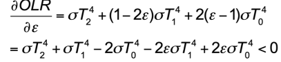

**What does the derivative of the OLR equation tell us:**  
As emissivity increases OLR decreases and therefore surface temp must increase  
Derivative is always negative because in our atmosphere temp surface < temp in layer 1 < temp in layer 2

**What is an example of a way to increase atmospheric emissivity:**  
Add CO2

**Why does adding CO2 to atmosphere increase emissivity:**  
The atmosphere emits more energy in comparison to surface so emissivity has increased (CO2 makes the atmosphere absorb more and therefore emit more)  
Makes the atmosphere more opaque

**Why does the temp profile have to be negative to get the Green house effect:**  
If the atmosphere absorbs outgoing radiation from the ground,  
OLR from the ground decreases but increases from the atmosphere  
But atmosphere is colder than ground so overall less energy escapes

**What would happen if atmosphere was same temp as ground:**  
No GHG effect  
There is more CO2 but kirchoff law says atmo will release as much as it absorbs  
And because atmo is same temp as earth, whether the OLR comes from the ground or atmo does not matter

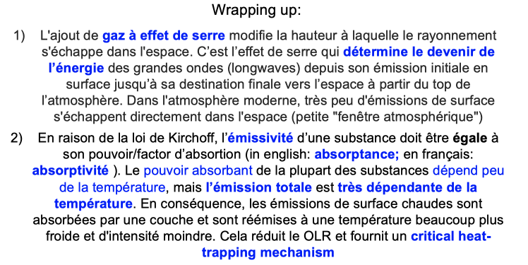

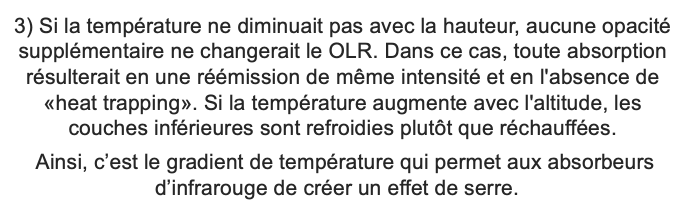

**When is the derivative of the OLR equation not negative and what does this mean for OLR:**  
When temp does not decrease with altitude like in stratosphere  
Emissivity increases so does OLR

**If temp increase with altitude more CO2 means more OLR, Why:**  
Because once again the outgoing energy’s final destination is the top of atmo,  
Now, the atmo is absorbing more energy (more emissivity)  
But is also re-emitting this energy at a higher temp because it is at a higher temp  
Therefore increases the amount of OLR and decrease earth temp

**If T0 > T1 > T2 and emissivity increases what happens to OLR:**  
Decreases

**If T0 < T1 < T2 and emissivity increases what happens to OLR:**  
Increases

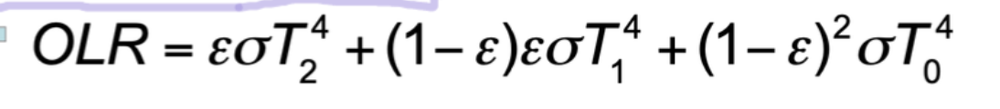

**If atmosphere ε = 1 what does this tell us about the atmosphere:**  
All outgoing radiation is absorbed by atmosphere and re-emitted by atmosphere

**What is radiative flux:**  
Amount of radiative energy per unit time  
Watts

**What is flux density / Irradiance:**  
Energy that passes through or is incident on a surface per unit time per unit area  
W/m2

**What is radiative intensity / Radiance:**  
Irradiance per unit solid angle (irradiance from a certain direction)  
W/m2\*sr

**The irradiance at the top of the atmosphere is a function of:**  
The distance between the earth and the sun

**If you double the distance between earth and the sun what happens to energy:**  
You get a quarter of the energy

**If you double the distance between earth and sun you get a quarter of the energy, why:**  
Sun emits in all direction (as a sphere)  
Inverse square law

**What is the zenith angle:**  
Angle between sun position and 90° to the surface

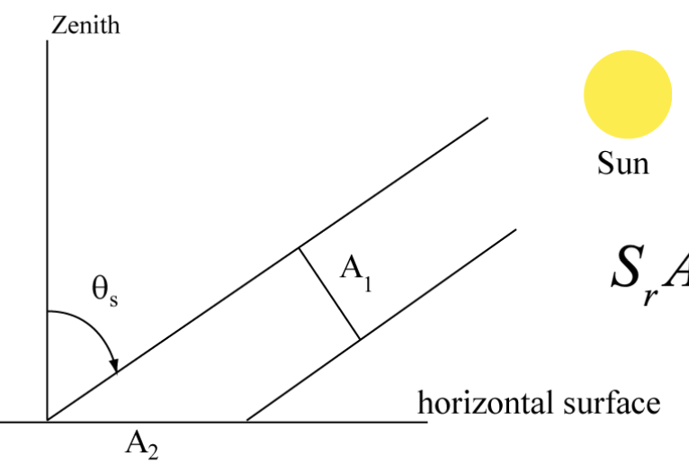

**How do you find how much energy is hitting earth when sun is at angle:**  
Multiply energy by cos(θ)

**Over the course of a year, the energy balance at the top of the atmo swings by how many W/m2 :**  
30 W/m2 (peak to peak swing)

**At what latitude do we start to get a global energy deficit:**  
40° N and S

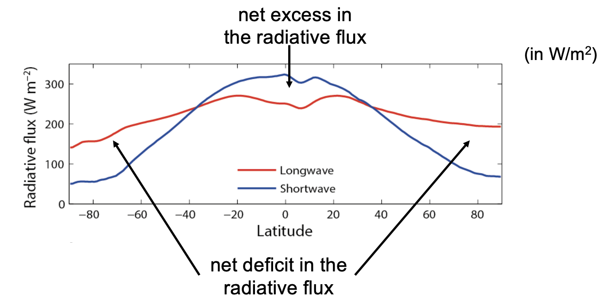

**Why does the sahara have relatively low solar flux:**  
Sand High albedo so most of it is reflected

**Why is the ocean albedo higher at higher latitudes:**  
Higher lats = Higher zenith = less dark ocean = higher albedo

**At what time does water have lowest albedo:**  
Noon

**In the tropics there is net … of energy and in the poles there is net … of energy:**  
Excess  
Deficit

**On a monthly/seasonal basis is the earth in energy equilibrium:**  
NO, there is a 3.5% insolation difference between summer and winter  
(also things like albedo change)

**When is there more shortwave energy incident on earth:**  
Winter, we are closer to sun (Aphehelion)

**Why is net solar flux lower over the Sahara than in the ocean at the same latitude:**  
Sand has high albedo

## Lecture 02.1:

### Horizontal Heat Transport ATM

**How is longwave and shortwave flux distributed differently across earth:**  
Both - More at equator less at poles  
BUT longwave - the diff between equator and pole is less than for shortwave

**How are the ocean and atmosphere different (3):**  
\- Atmosphere has much lower density  
\- Atmosphere is compressible  
\- Atmosphere is not confined to basin

**What is the major similarity between the ocean and atmosphere:**  
Both fluids

**Does the atmosphere or ocean transport more heat:**  
Atmosphere by a lot

**How does the proportion of energy transported by the atmosphere vs the ocean change with latitude:**  
The diff between energy transported is greater at mid latitudes than at equator  
At mid latitudes, the atmosphere transports much more than the ocean Compared to at the equator

**Where is the only place that the ocean transports more energy the atmosphere:**  
Equator and only by a little bit

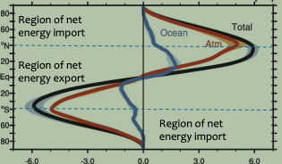

**If there was no ocean transporting energy at equator what would happen to global energy transport:**  
The atmosphere would transport more  
It needs to balance

**Energy out of an atmospheric column equals the sum of (3):**  
\- Net radiative Heating (Short+longwave)  
\- Condensation latent heat  
\- Sensible heat from surface to atmosphere

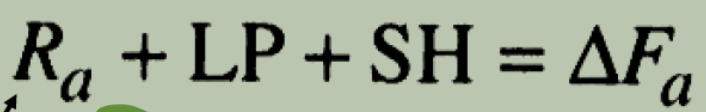

**What is convection:**  
Warmer less dense things rise above colder denser things

**What is the Mean Meridional Circulation (MMC):**  
The three main convection cells on earth  
(Hadley, Ferrel, Polar)

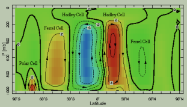

**Which of the MMCs are indirect and what does this mean:**  
Ferrel is indirect

Cold air rises hot air sinks  
Driven by mid lat eddies not thermally driven

**What MMC does not transport energy poleward:**  
Ferrel

**Why are MMC cells more intense in the southern hemisphere (2):**  
\- Less land (no wind interruption)  
\- High temp gradient (Antarctica very cold)

**How do you calculate time mean of total eddy flux and what does it mean:**  
N/S Wind speed \* Temperature [averaged around a latitude]  
Flux of energy being transported north

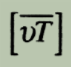

**Total eddy flux consists of these terms (3):**  
\- MMC  
\- Stationary eddies (monsoons, mountains)  
\- Transient eddies (storms)

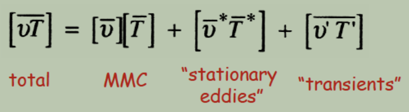

**Stationary eddies are also known as:**  
Stationary Rosby waves

**What are Rosby waves:**  
Waves in the atmosphere

**What is a general place where stationary Eddie’s would contribute a lot:**  
Mountain ranges  
(Rockies, Himalayas)

**Transient Eddie’s are deviations from …:**  
Time mean (‘)

**Stationary Eddie’s are deviations from …:**  
Zonal mean (\*)

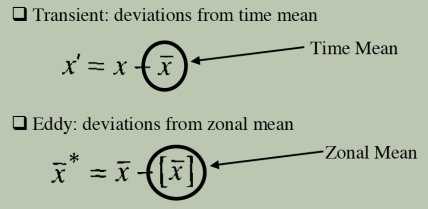

**The jet stream is not an eddy it is apart of the:**  
Mean flow

**What parts of the jet stream can be stationary / transient eddies:**  
Stationary = meanders  
Transient = Storms moving along and branching off the jet

**Where and when is the strongest flux of energy due to stationary and transient eddies:**  
50° N in winter hemisphere (Cyclones)  
(cause arctic is cold causing strong gradient)

**Why is it that below 15° N eddy energy transport drops off:**  
Temp gradient is much much weaker

**Where does energy flux by eddy transport dominate over flux by MMC:**  
Extratropics All around 45°

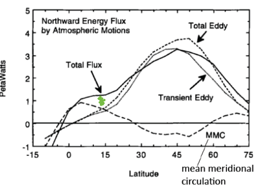

## Lecture 02.2:

### Horizontal Heat Transport OCN

**Ocean density is a function of (3):**  
\- Temp  
\- Pressure  
\- Salinity

**In ATLANTIC ocean the heat transport is always:**  
Northward (even in SH)

**The Ocean density function is non:**  
Non linear

**At what temp does sea ice form:**  
-1.8°C (~2°C)

**Generally, the oceans salinity varies between:**  
32-37 PSU

**Very generally where is salinity highest in the ocean:**  
Where water evaporates a lot

**Why does the arctic have so much freshwater (2):**  
\- Low evaporation

\- Lots of rivers

**Ocean density is always measured in relation to:**  
A reference density  
Normally 100kg/m3

**When water temperature is low, density is increasingly depended on:**  
Salt content

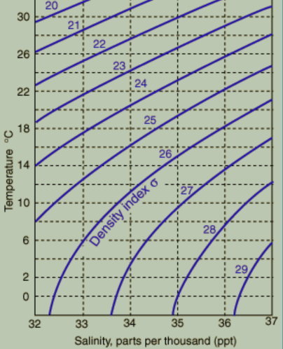

**As salinity increases, freezing temp:**  
Decreases

**How does density's relationship with temperature differ between fresh and salty water:**  
Below 4 °C fresh water actually starts to get less dense  
Salt water increases density all the way until it freezes at -2 °C

**Salt water reaches it max density at what temperature:**  
-3.5°C

**How is sea ice formation different in fresh vs salty water:**  
\- In fresh water only the top layers needs to get to 0 °C to freeze  
\- In salt water the whole water column needs to reach freezing temp in order  
to stop convection from moving the very cold top layer down which curls warmer water up and stops freezing

**In the water density formula what is alpha:**

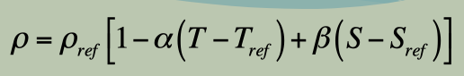

Coefficient of thermal dilation  
Increases as water pressure increases

**What is the Thermobaric effect:**  
Colder water is more compressible that warmer water  
VeryCold-Fresh water sinks more than Warm-VerySalty water

**Why does colder water sink more that warmer water:**  
Colder water is more compressible  
As it sinks it gains density more than warmer water would

**Where is water the ‘lightest’ (least dense) (2):**  
Tropics (hot) + Near river mouths (fresh input)  
South-East Asia

**What is the pyrocline:**  
Layer where water density increases rapidly with depth

**What is the thermocline:**  
Layer where water temp changes rapidly with depth

**What is the halocline:**  
Layer where water salinity changes rapidly with depth

**The depth of the ocean mixed layer varies with (2):**  
\- Latitude  
\- Season/Temperature

**Where is there no ocean mixed layer and why:**  
At the poles  
Deep water makes it to surface here

**Where is the mixed layer deepest and shallowest (besides poles):**  
Deepest = Mid latitudes in N and S (Lots of wind mixing and temperature change)  
Shallowest = Equator (Constant hot water capping the surface)

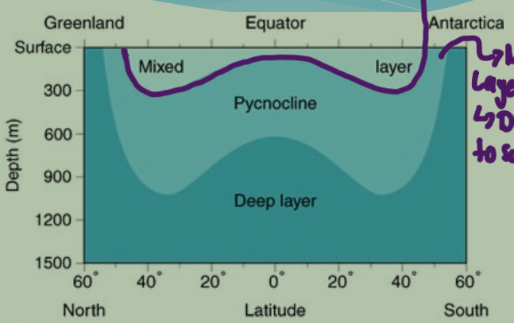

**At what depth does density largely stop increasing:**  
1 km

**When does the mixed layer mix the most and why:**  
Winter - mix layer depth is deeper  
More winds for mixing

## Lecture 02.3:

### Ocean Circulation

**What are the two types of upwelling:**  
\- Wind driven  
\- Mixing driven

**What is an Eckman spiral (3):**

\- Wind stress causes ocean current  
\- Coriolis effect deflects ocean current  
\- Current pulls water below it decreasing in strength with depth

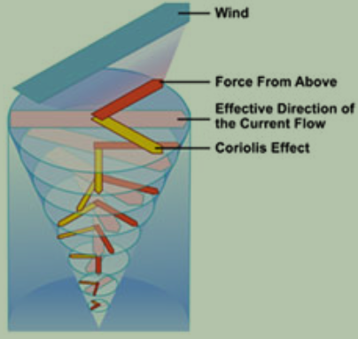

**Eckman transport occurs at what angle to the prevailing wind direction:**  
90° (The net of the corkscrew spiral going downwards)

**How do Eckman spirals cause upwelling (2):**  
\- Ekman transport pushes water one direction  
\- Water is upwelled to replace transported water

**What are two types of wind driven upwelling:**  
\- Equatorial  
\- Coastal

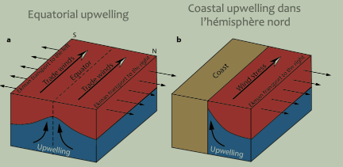

**Generally, what causes oceanic gyres (2):**  
Winds going in opposite directions  
With land containing everything

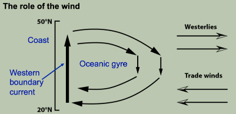

**What is an STG and SPG:**  
Sub tropical and Sub polar Gyres

**In the NH what is the name of the STG:**  
Gulf Stream

**What are internal waves:**  
Waves that form in the ocean depths at density boundary layers

**What can initiate internal waves (2):**  
\- Tides

\- Wind

**How do internal waves creates mixing driven upwelling:**  
When they break it creates turbulence and mixes some heat downwards  
Slightly warmer water moves up and cold bottom water replaces it

**Deep Water wind driven upwelling only occurs in this ocean, why?:**  
Southern ocean  
\- Strong winds  
\- Almost no boundary layer

**What is the densest water in the world:**  
Antarctic Bottom Water (AABW)

**How does ocean freezing create deep water formation:**  
Salt is released with makes surrounding water sink

**Why is there much less deep water formation in the pacific:**  
It is much less salty compared to atlantic

**Why is the pacific much less salty than the atlantic (4):**  
\- Less evaporation  
\- More rain  
\- More volume  
\- One way exchange with Atlantic - easterlies bring water vapour from atlantic to pacific but rockies stop westerlies from doing the reverse

## Lecture 03.1:

### Teleconnections ENSO and PDO

**What is the name of the circulation that composes the ENSO:**  
Walker

**Under normal conditions what does the pacific look like (2):**  
\- Warm pool near indo  
\- Colder tongue extending from Peru out into the pacific

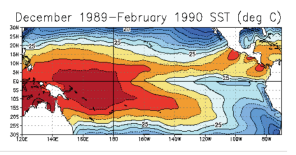

**When is the ENSO the strongest:**  
December

**What is the ocean thermostat mechanism (5 steps):**  
\- Atmosphere gets uniform cooling (like an aerosol cloud)  
\- In warm pool there is almost no upwelling so it cools more than the east side (east side much more stable due to upwelling  
\- Reduces the E-W temperature gradient  
\- E-W trade winds weaken

\- El nino like condos

**How does the ocean thermostat mechanism related to the GHG effect:**  
The opposite effect occurs  
East warms more than west  
More trade winds  
La nina conditions

**What do El Nino conditions look like:**  
Warm pool extends into center of pacific and SA coast is warm

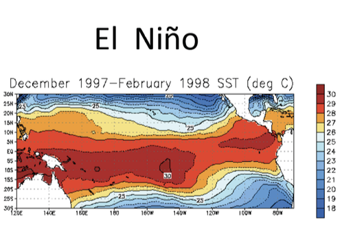

**What do La Nina conditions look like:**  
Very cold tongue extends from peru to mid pacific

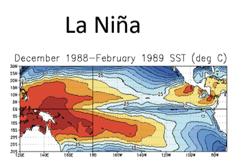

**La nina are … but … :**  
Less intense but last longer

**What is the Southern Oscillation ENSO index and why is it not great:**  
Pressure diff between Darwin and Tahiti  
ENSO is on equator but these locations are not on equator

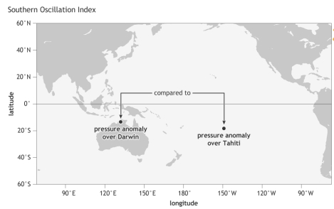

**What is the Equatorial Southern Oscillation ENSO Index:**  
Pressure diff between Indo and east equatorial pacific

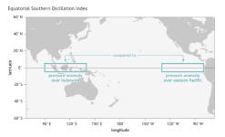

**What is the SST ENSO Index:**  
Looks at SST at different parts of equatorial pacific

**What is the OLR ENSO Index and how does it work:**  
Less OLR = more clouds = warmer area  
More OLR means warmer but more importantly means less clouds  
Cloud position is defining feature of ENSO  
(More OLR cant be explain by temp alone, in reality we are measuring OLR from ground and not cloud top)

(Blue = less OLR, Red = more)

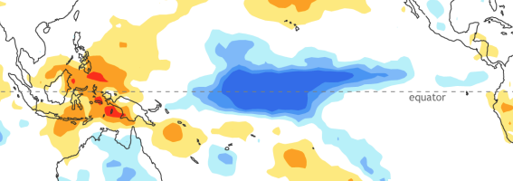

**Does the image above represents El nino or La nina conditions, why:**  
El Nino  
Low OLR over mid atlantic = lots of clouds over mid atlantic, these are el nino conditions

**The ESNO index combines:**  
The strengths of many indices

**The ENSO return period is about:**  
3-6 years

**What are the two types of El Nino:**  
\- Cold Tongue  
\- Warm pool

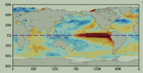

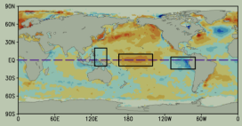

**What is the Bjerknes feedback (6 steps):**

1. Trade Winds Weaken
2. Warm water flows / pools up in the east pacific
3. East pacific thermocline deepens
4. East pacific upwelling brings up less cold water
5. East-West temperature gradient decreases
6. Trade Winds Weaken

**How does a cold tongue El Nino atmospherically affect the Aleutian low:**  
Rossby (pressure) waves go north  
Aleutian low deepens and intensifies  
Less upwelling (less offshore wind)

**How does a cold tongue El Nino oceanically affect the Aleutian low:**  
Kelvin waves bounce off NA sending warm water north  
Changes shape of Aleutian low by warming California region

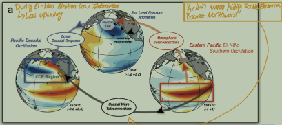

Creating Horseshoe of warm water along NA coastline

**What overall effect does El Nino affecting Aleutian low have:**  
Contributes to the Pacific Decadal Oscillation (PDO)

**A warm pool / Modoki El Nino contributes to what process:**  
North Pacific Gyre Oscillation

**What does the warm and cold phase of the PDO look like:**  
Warm = Cold elution low, hot West NA coastline and hot tongue off SA  
Cold = Hot elution low, cold West NA coastline and cold tongue off SA

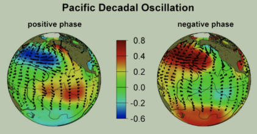

**The PDO is on what time scale:**  
Decadal ~ 20-30 year

**What mechanisms makes it so the PDO is on a decadal time scale (3):**  
\- The SST anomaly in the winter gets pushed down deep with the deep winter MLD  
\- During the summer the MLD rises but the SST anomaly stays deep meaning it can’t exchange its energy  
\- In winter the MLD plunges again and the SST can come back up to either be reinforced or lose its anomaly

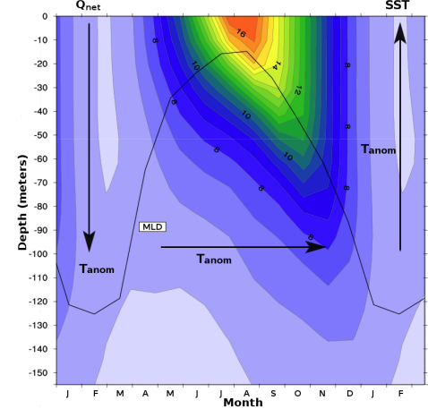

**The PDO has a … effect on the ENSO climate regime:**  
Modulating

**When we are in the +PDO phase what kind of ENSO more likely and more intense:**  
El Nino

## Lecture 03.2:

### Teleconnections PNA to SAM

**What is the atmospheric flavour of the PDO:**  
PNA

**What does PNA stand for:**  
Pacific North American Pattern

**Positive PNA phases are associated with:**  
El Nino / (+) PDO  
Negative PNA with La Nina

**How does pressure and temperature change with diff PNA phases:**  
Positive PNA = High pressure and temp West NA, Low pressure and temp East NA  
Negative PNA = Vice Versa

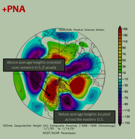

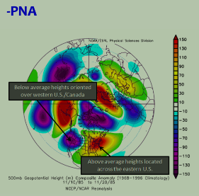

**What other oscillation affect the PNA:**  
PDO

**How does the PDO affect the PNA:**  
Waters off BC change air temp and make jet stream meander  
Leading to +/- PNA

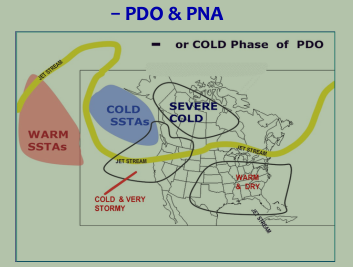

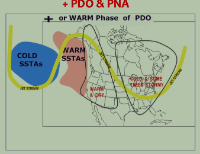

**During the (+)PDO phase, what makes it so the south east is colder:**  
Jet stream brings cold air down from high latitudes

**During the (+)PDO phase what determines the intensity and direction of south east NA cooling:**  
The shape and intensity of meandering jet stream bringing cold air down

**What does NAO stand for:**  
North Atlantic Oscillation

**The NAO is defined by the pressure difference between:**  
Iceland and Azores

**What does the (+)NAO and (-)NAO phase look like:**  
(+) = Low pressure over arctic / High pressure in mid Atlantic  
(-) = High pressure over arctic / Low pressure in mid Atlantic

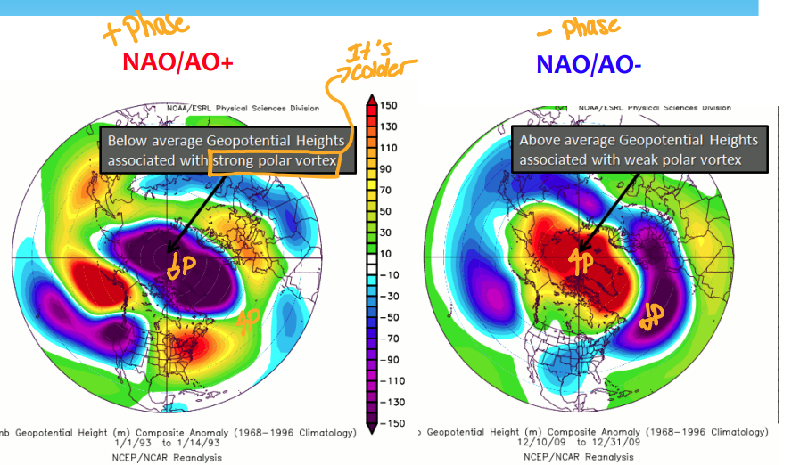

**The concentration of low arctic pressure of the (+)NAO phase leads to:**  
Strong polar vortex - colder

**(+)NAO give what kind of winters:**  
Boring (We are in a high pressure system) (Low pressure is over arctic)

**What are the two types of jet stream extratropical flow variability:**  
\- Jet meandering  
\- Jet pulsation

**In the pacific does jet meandering or pulsation dominate:**  
Pulsation

**What are the two types of jet streams:**  
\- Thermally driven (north-south energy gradient)  
\- Eddy driven (storms)

**Jet meandering and pulsation affect what kind of jet streams:**  
Meandering = Eddy driven  
Pulsation = Thermal driven

**What really creates the NAO:**  
Variability of the eddy-driven jet

**Why is the jet stream in the Atlantic more susceptible to meandering (2):**  
\- Storms form and move northward which create a separate eddy driven jet stream (polar jet stream)  
\- Relatively weak - does not anchor eddy driven jet

**What kind of stratospheric polar vortex leads to (+)NAO:**  
Strong northern polar jet stream

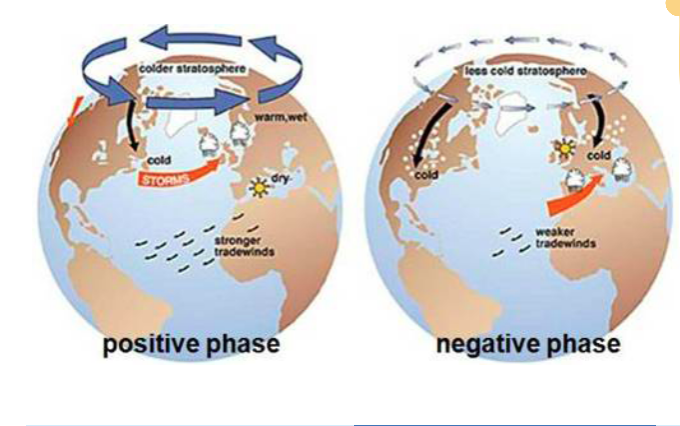

**Vortex splitting leads to what NAO phase:**  
(-) Negative

**How does vortex splitting lead to (-)NAO (3):**  
\- Cold air over arctic is split in two by high pressure system  
\- Cold air is pushed downwards  
\- The eddy-driven jet weakens and shifts south

**How do volcanoes and GHG affect the NAO:**  
Increase N-S temperature gradient

**What does increasing the N-S temp gradient do to the NAO:**  
Reinforcing the polar vortex  
More (+)NAO

**What are the effects of a (+)NAO (4):**  
\- Strong westerly winds  
\- Warm US Winter  
\- Med gets drought  
\- North Europe gets warm

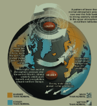

**What are the effects of a (-)NAO (4):**  
\- Weak westerlies  
\- Cold arctic air reaches south US  
\- North europe/asia get cold winter  
\- Stormy med

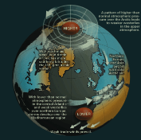

**How are storms different in (+)NAO:**  
Lots of strong storms that all follow a path  
(the eddy driven jet stream path)

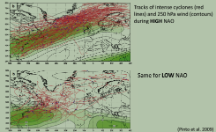

**What does AMO stand for:**  
Atlantic Multi decadal Oscillation

**The AMO has what period:**  
60-80 years

**The AMO is affected heavily by:**  
The AMOC

**The AMO is defined by this climate variable:**  
North Atlantic SST

**What are the effects of a hot phase AMO (5):**  
\- Stronger west africa monsoon  
\- Stronger summer indian monsoon  
\- Stronger hurricanes  
\- Drought in mid and south west US  
\- More rain in Florida and PNW

**What does MJO stand for:**  
Madden Julien Oscillation

**The MJO has what kind of time scale:**  
Weekly to monthly

**What makes the MJO different from other oscillations:**  
It moves

**What pattern does the MJO move in:**  
Moves eastward of indian and pacific ocean at 4-8 m/s

**Why is the MJO only really over the indian and pacific ocean:**  
Atlantic is too cold to get very rainy conditions  
Pacific warm pool is large, warm and moist

**How does the MJO manifest (2):**  
Rainfall anomalies  
\- Area of high rainfall  
\- Followed by low rainfall before and after

**How does the MJO affect monsoons:**  
Warm phase - clear skies and calm winds warm SST  
“Primes” monsoons making them stronger

**How does the MJO affect cyclones:**

They cluster around the warm phase

**How does the MJO affect El Nino:**  
\- Strong western winds can help trigger El Nino  
They often proceed El Nino  
\- But it is often more active during La Nina

**What is the Pineapple Express:**  
Atmospheric River that brings precip from Hawaii to Vancouver

**What causes the Pineapple Express:**  
Jet stream splits around a high pressure system off west NA (Which itself was created by MJO)  
Jet stream pulls precip from passing by MJO towards vancouver

**How is the Atlantic El Nino different from the ENSO (3):**  
\- When in warm phase whole area warms (not warm in east, cold in west like ENSO)  
\- Is much more on an annual timescales (varies on shorter time scale)  
\- Peak in the summer

**What are the two main effects of a warm Atlantic Nino:**  
\- Weaker west africa monsoon (drought further inland Africa)  
\- Pushes ENSO into La Nina

**Why does the warm Atlantic Nino reduce monsoons:**  
Makes the water hotter in the summer, decreasing water-land temp gradient

**What do the positive and negative Indian Nino look like:**  
Positive = Hot + more convection off africa coast, cold in south east asia  
Cold = Temperature are vice versa

**How is indian nino index different from the other ninos:**  
Positive phase = trade winds intensify

**How long does an Indian Nino last:**  
About 6 months

**When does the Indian Nino normally start and peak:**  
Starts in May/June peaks in August/October

**What stops the Indian Nino:**  
Monosson coming in SH spring (NH fall)

**What does SAM stand for:**  
Southern Annular Mode

**What physical process defines the SAM:**  
North-South movement of antarctica atmospheric current

**How does the positive and negative SAM affect the Antarctic atmospheric current:**  
Negative phase pushes low pressure current outwards

**Does a positive or negative SAM bring more storms:**  
Negative SAM

**Why does a negative SAM bring more storms:**  
Polar current pushes away from antarctica creating stronger winds and lower lows

**What would happen if the AMOC shut down:**  
Colder in North Atlantic  
Hotter in Mid-South Atlantic

## Lecture 04:

### Climate Stability

**Earth's climate varies but overall is very … :**  
Stable

**What is a point de bascule:**  
Tipping point

**What are 2 requirements for conditions to be stable:**  
\- There is equilibrium  
\- It is stable to small forcings

**What is the definition of a forcing:**  
Something that causes desiquilibrium

**What is a feedback:**  
When outputs are re-inputed

**What are the 3 types of forcings:**  
\- Instantaneous radiative forcing  
\- Stratospherically adjusted radiative forcing  
\- Effective radiative forcing

**What is Instantaneous radiative forcing:**  
After forcing change, instantaneous energy flux change at the tropopause  
(no temp has really changed yet)

**What is Stratospherically adjusted radiative forcing:**  
After forcing, let stratosphere reach new T equilibrium, then measure energy flux at tropopause

**What is Effective radiative forcing:**  
After forcing, let fast atmospheric components adjust but don't let slow ones adjust (land, ocean)  
and measure energy flux at Top of Atmosphere

**What are two major natural forcings:**  
\- Solar forcing (insolation change)  
\- Volcanic forcing

**What are 4 GHGs that cause significant forcing in order (most least) of RF:**  
\- CO2 (1.66)  
\- Methane (0.48)  
\- Halocarbons  
\- NOx (0.16)

**The gas with the highest global warming potential:**  
SF6

**What is another atmospheric forcings besides GHG:**  
Aerosols

**What are direct and indirect aerosol forcings:**  
Direct = Aerosols interact (scatter and absorb) light directly  
Indirect = Aerosols interact with clouds that then affecting forcing

**What is the new terminology for direct and indirect aerosol forcings:**  
Direct = Aerosol-Radiation Interactions  
Indirect = Aerosol-Cloud Interactions

**What are the 3 Aerosol-Cloud interactions:**  
\- Cloud albedo affect  
\- Cloud lifetime effect  
\- Cloud burnoff

**Are Aerosol-Cloud interactions forcings or feedbacks:**  
Forcings

**What is the cloud albedo effect:**  
\- Aerosols seed clouds  
\- This leads to more smaller droplet clouds  
\- Reflects more sunlight

**What is the cloud lifetime effect (3):**  
\- Small droplets have hard time growing into raindrops  
\- So drizzle is suppressed  
\- Clouds last longer, reflect more light

**What is cloud burnoff:**  
Aerosols absorbing energy warms the air  
This burns off clouds

**Cloud burnoff is actually what kind of aerosol forcing:**  
Semi-Direct

**What is causing aerosols over the pacific:**  
Salt

**In the pacific, why are there more aerosols in the mid latitudes:**  
More wind means more salt picked up into atmosphere

**What is causing aerosols over africa:**  
Sand

**What is the ice albedo feedback:**  
\- More cold  
\- More ice and snow  
\- More energy reflected  
\- More cold

**What is the water vapor feedback:**  
\- More hot  
\- Air expands  
\- More water vapor in air  
\- More hot

**What is the lapse rate feedback at the equator:**  
\- More hot  
\- IF atmosphere warms more than surface  
\- Lapse rate decreases (Increases slope)

\- Energy emitted at higher temp (atmosphere is now hotter)  
\- Earth cools (on graph, slope is steeper so X intercept is less)

(Left = no lapse rate change so no normal condos, Right = lapse rate changed so its less hot)

**Why does the atmosphere heat more than the land at the tropics:**  
High evaporation rate cools the surface and releases latent heat in the atmosphere

**Dans la région tropic, le réchauffement climatique plus élevé est détecté en altitude**  
**à cause de la chaleur sensible vrai ou faux:**  
False, it’s because of latent heat

**How is the lapse rate feedback different at the poles:**  
\- More hot  
\- The ground warms more than the atmosphere  
\- The lapse rate actually increases  
\- More Energy is emitted at same temp  
\- Earth warms

**Why does the surface warm more than the atmosphere at the poles:**  
Very stable atmosphere so warming gets stuck at surface and does not mix upwards

**Cloud feedback depends heavily on this cloud characteristic:**  
The height of the clouds

**What clouds warm and what clouds cool:**  
High clouds = Warm (tops are cold)  
Low clouds = Cool (tops are warm, thick and bright)

**Are clouds feedbacks positive or negative:**  
Mostly positive but debated

**What is the main assumption in climate feedback theory:**  
The TOA Flux is proportional to the change in temperature

or

**What is λin the equation above:**  
Climate feedback parameter - Parametre retroactive climatique

**How is the climate feedback parameter measured:**  
For each 1 K of warming, how many extra W/m² does the planet gain or lose

**What does is mean if λis very negative:**  
Strong damping (negative feedback)

**What is the equation for change in temperature due to a forcing at equilibrium:**  
ΔTs = - R / λ  
Where R is a forcing

**Why does λtotal just equal to the sum of all individual λ:**  
Because there is a linear relationship with ΔTs

**What are the feedback components of λ:**  
\- Shortwave (changes in albedo)  
\- Longwave (changes in emissivity)  
\- Planck's feedback (negative feedback, warmer bodies radiate more)

**What is the standard measure of climate sensitivity:**  
Double CO2

**How much is the current forcing from anthropogenic CO2:**  
R = 1.95 W/m2

**What is the radiative forcing (R) of doubling CO2:**  
Around 4 W/m2

**What value of temp change do models give us for a doubling of CO2:**  
1.2 K

**The IPCC reports what warming range due to doubling CO2:**  
1.5 to 4.5 K

**Why is the IPCC ECS range so high (2):**  
\- Complicated feedbacks - Cloud  
\- Non linear ECS / Feedback relationship - As feedbacks reach 0, a small change in feedback create large ECS change  
\- General model uncertainty - not as important / interesting

**Why do climate models underestimate climate sensitivity:**  
They only account for planck feedback and not albedo/emissivity changes  
They are leaving out important feedbacks

**If we consider the ΔT from 2XCO2 to be 3 K (middle of the range)**  
**what value for λ do we get:**  
-1.3

**Considering this λ= -1.3 value, in this scenario**  
**what is the λfor planck feedback and non planck feedbacks:**  
Planck feedback λ= -3.3 (known)  
Non Planck feedbacks λ= +2 (calculated from λ= sum of all λ)

**What do these planck and non plank λvalues tell us about climate stability:**  
Non planck feedbacks are positive and cause climate instability  
But the negative planck feedback outbalances this and makes climate stable overall

**What is equilibrium climate sensitivity (ECS):**  
Global heating necessary to bring earth back into equilibrium after doubling of CO2

## Lecture 5.1:

### Water Cycle

## Lecture 5.2:

### Carbon Cycle

## Lecture 5.3:

### Methan Cycle

## Lecture 6.0:

### Climate Models

## Lecture 7.1:

### Current Climate Change

**What is climatic causality:**  
Link between forcing and observed change

**Is solar forcing a significant driver of climate change, and what is the confidence:**  
Not in the last 9000 years  
(high)

**What are some key volcanic forcing events (4):**  
\- Pinatubo  
\- El Chichon  
\- Agung  
\- Krakatoa

**Is volcanic activity not normal since 1900 and what is its confidence:**  
No
(Medium confidence)

**In 2019 what was the atmospheric CO2 concentration:**  
409.9 ppm

**CO2 concentrations are the highest in how many years and what is the confidence:**  
2 million years  
high confidence

**What is the methane concentration in 2019:**  
1866.3 ppb

**What is the concentration of N20 in 2019:**  
332.1 ppb

**What was the substitute for CFC:**  
HCFC

**What is the bio physical effect of land use change:**  
Deforestation and Agriculture increase albedo

**Biophysic effect of land use change does what to climate:**  
Cools

**Land use change is one of the few human effects that cause:**  
Cooling

**The concentration of tropospheric aerosols at mid latitudes in NH has ... since ... then ... :**  
increased since 1700 then decreased after 1975 ish

**Less aerosols means what for climate:**  
Warmer

**Since when has the been an imbalance in energy flux:**  
1970

**What is causing the imbalance in energy flux:**  
Excessive absorption

**The heating of ... is the principal factor explaining the variation in energy inventory:**  
Ocean heating (high confidence)

**What is the principal contributor to the positive energy forcing:**  
CO2

**What are the 4 earth systems that we can see effects of climate change:**  
Ocean  
Atmosphere  
Biosphere  
Cryosphere
(these are all the systems)

**There has been how much warming during the 2011-2020 period:**  
+1.09 deg C relative to 1850-1900 base period

**When did warming accelerate:**  
After 1970

**What region warms the most:**  
Arctic

**Does the ocean or land warm more:**  
Land (1.5 °C vs 0.88 °C)

**How has temp change in the troposphere and stratosphere:**  
Tropo = Warming  
Strato = Cooling

**How has tropopause height changed between 1980 and 2018:**  
Increased globally

**The global water cycle has ... since 1980:**  
Intensified

**How has total water vapour in atmosphere changed:**  
Increased  
More hot = can hold more water

**How has precipitation changed since 1950:**  
Increased

**When was there a steep acceleration of precipitation increase:**  
1980

**How is the water balance dominated differently in the ocean and on land:**  
Land = more rain  
Ocean = more precipitation

**Monsoon precipitation has ... since the 1981 with a ... confidence:**  
increased with a medium confidence

**The number of extra tropical cyclones has ... in the NH and SH:**  
probably increased

**How has the Hadley cell changed since 1980:**  
Widened and strengthened

**How is the change in arctic and antarctic sea ice different:**  
Antarctica has not declined like the arctic (trend is not clear)

**Temperature in the top ... m of ground has ... :**  
Top 30 m of ground has risen

**How has salinity changed since 1950:**  
Salinity contrast at large scale has increased

**The AMOC has been stable for the last ... years but has started to ... in ... :**  
Stable in the last 8000 years but has started to decline in the 20th century

**Sea level has ... and this has ... in the 20th century:**  
It has increased and this increase is accelerating

**Since 1901 how much has sea level risen:**  
0.15 to 0.25 m

**With climate change animals have been migrating:**  
Polewards

**What is verdissement:**  
Greening, more foliage

**how has CO2 seasonal cycle changed:**  
Seasonal swing has increased (High confidence)

## Lecture 7.2:

### Extreme Climate Change

**Climate change does what to extreme events ():**  
\- Larger magnitude  
\- Increase frequency  
\- New locations  
\- Different timing  
\- New combos

**What is the definition of an extreme event:**  
Rare events that occur at extremities of the distribution of all climatic variability

**What is an extreme weather event:**  
A rare event at a location at a specific time of the year

**What is an extreme climate event:**  
An ensemble of extreme weather phenomena that persist during a certain time (like a season)

**In addition to influencing the frequency, and intensity of extreme events, climate change can also effect:**  
The probabilistic distribution(increased variability, changes in symmetry), which causes the above changes

[diagram slide 8]

**Also climate change affects extreme events ... :**  
They still occur regardless

**What is the issue with questions asked about the relationship between climate change and extreme events:**  
Often too specific and can't be answered by science

**How to reword this question into a scientific way:**  
To what extent has climate change altered the probability and intensity of an observed event

**This rewording of questions into a more scientific language is called:**  
Extreme event distribution

**What are the types of climate extremes:**  
\- Temp  
\- Precip  
\- Flood  
\- Drought  
\- Storms  
\- Combos

**What is a combo extreme event:**  
Two or more events that alone are not devastating but are when combined

**Combo events are by definition about:**  
Teleconnections

**What are the climate extreme indexes:**  
\- Max and Min values  
\- Percentiles  
\- Length and intensity  
\- Crossing a societal threshold

**What is the drought index talked about in the lecture:**  
DrinC - Drought index calculator

**The DrinC is composed of:**  
Many different indexes

**What is the precip index talked about in the lecture and how do you calculate it:**  
Standardized Precipitation indexes  
SPI = Monthly precip - Mean precip / STD of monthly precip

**What is a normal conditions SPI value:**  
0.99 to -0.99

**What are the two storm indexes mentioned in the lecture and how are they measured:**  
MUCAPE = Atmospheric instability  
Kindex & Totalx = Thunderstorm potential

**Future changes in temp averages and extremes will be:**  
Similar

**Future changes in precip averages and extremes can:**  
Vary differently

[Diagram on slide 22]

**The direction and intensity of future extremes compared to the average depends on:**  
The variable we are looking at

**What is TXx:**  
Highest daily max in each year

**What is TNn:**  
Lowest daily min in each year

**What is TX90p:**  
Number of days above the 90th percentile

Front: What does “heterogeneous at the regional scale” mean for climate change, and why does it happen?

What does “heterogeneous at the regional scale” mean for climate change, and why does it happen?

**What does “heterogeneous at the regional scale” mean for climate change, and why does it happen:**  
Climate change effects vary a lot from place to place. Some regions warm much faster than the global average because of natural climate variability and local processes and feedback. So regional impacts can differ greatly from the global signal

A small change in temperature can cause;  
A large change in extreme events

**Frequency and intensity of strong precip has … increased at a … scale over most terrestrial regions:**  
Probably increased  
Global scale

**Strong precip has … increased at a … scale over … continents where there is the most data:**  
Probably increased  
at a continental scale  
Over 3 continents (NA, EU, AS)

**Strong precip generally becomes more … and … with global warming:**  
More frequent and intense

**The augmentation of frequency and intensity of extreme precip is … for the majority of continents**  
**and … for the majority of regions:**  
Extremely Probable  
Very probable

**What has changed about floods in colder regions and why:**  
Seasonality  
Snow melt changes

**Hydrological models project what about future flooding:**  
There will be more

**what is a drought:**  
Abnormally dry period that leads to disequilibrium in hydrological cycle

**What is a meteorology drought:**  
not enough rain

**What is a hydrological drought:**  
not enough ground water / water in rivers

**What causes a agriculture and ecological drought:**  
When plants are water stressed

**Climate change increasing drought is at what confidence level:**  
Eleve

**When it comes to drought there is a lot of … and … :**  
Uncertainty and regional differences

**Where are droughts expected to get worse:**  
\- Africa  
\- Australia  
\- Mediterranean  
\- East Asia

**It is … that rainfall will rates will increase:**  
Very probable

**How will the latitude of max intensity change in the western north pacific and what is the confidence for this:**  
Shift poleward  
Probable

**How will tropical cyclone frequency change and what is its confidence:**  
Less or the same number of storms  
Probable

**How will peak wind speed and the share of Cat 4-5 storms change and what is the confidence on this:**  
Increase  
Very probable

**The frequency or intensity of all extreme events has increased and will keep increasing with stronger warming, Except:**  
Cold waves

**What are the two drivers of change in extremes:**  
Thermodynamics  
Dynamics

**What are thermodynamics driving extreme changes:**  
Regulated by local heat exchange  
Responses and feedbacks from surface processes

**What are dynamic drivers of extreme change:**  
Atmospheric and Oceanic movement  
Things that modify weather phenomena

**What aspects of the global atmospheric circulation are expected to change:**  
\- Hadley gets bigger  
\- Poleward shift of extratropical jet and storm track  
\- Changing frequency of ENSO events

**At the regional scale, what shapes changes in temperature extremes:**  
\- Feedbacks  
\- Local and regional forcings  
\- Natural variability

**What are some specific things that affect temperature extremes:**  
\- Anthropogenic aerosols  
\- irrigation and cropland expansion  
\- Urbanization

The key message is that greenhouse gases set the overall warming trend, but local land use, aerosols, and natural variability can make the temperature extremes in a given place stronger or weaker than the global signal.

**How do thermodynamic drivers affect precip extremes:**  
Warmer air holds more water

**How do dynamic drivers affect precip:**  
Changes in atmospheric patterns

**In terms of precip, thermodynamic drivers are more … scale while dynamic drivers are more … :**  
Thermodynamic are more global while dynamic are regional and more uncertain

**What are some factors that affect flooding:**  
\- Amount and intensity of precip  
\- Soil humidity  
\- Water to snow ratio  
\- River morphology  
\- Fluvial engineering  
\- Land use and cover

**How do thermodynamic drivers affect drought:**  
increase in atmospheric evaporative demand caused by changes in temp, wind speed, relative humidity

**How do dynamic drivers affect drought:**  
Changes in sunshine duration

**what is the attribution process for extreme events:**  
\- Identify  
\- Observer  
\- Hypothesize  
\- Test hypothesis
\- Attribute assessment

[image on side 41]

**What is detection Vs attribution of extreme events:**  
Detection = At what point is an event abnormal in reference to normal climate  
Attribution = What is the most probable cause of the event

**What are the necessary components for Attribution of extreme events:**  
\- Model physics / stats  
\- Method stats

**What are tools for attribution of extreme events:**  
\- Observational data  
\- Model simulations

**What are the two main approaches to the attribution of extreme events:**  
\- Risk based approach  
\- Narrative approach

**What is the risk based approach:**  
How does the probability of a group of events happening change with anthro influence

**What it the narrative approach:**  
Asks two questions  
\- Can the event be explained by atmospheric variability  
\- How has anthro affected this atmospheric variability

**Climate change affects what part of the world:**  
All of it

**What are the 3 categories of impacts:**  
\- Human and society systems  
\- Ecosystem  
\- Natural physical environment

**The impact of an extreme event on a population and/or system depends on:**  
\- Degree of exposure  
\- Vulnerability  
\- Magnitude of event

**Extreme impacts don't need ... :**  
Extreme events

**What are the two combined conditions that can lead to a catastrophe:**  
\- Dangerous physical event  
\- Vulnerable societal conditions

**What is risk and how do you calculate it:**  
Potential for negative consequences

Risk = Probability of a dangerous event \* Gravity of its consequences

**What are risques potentiellement grave:**  
Principal risks that cause lots of harm at a large scale

**How many representative key risks are there and name 3:**  
8  
\- Low lying coastal systems  
\- Terrestrial and marine ecosystems  
\- critical infrastructure networks and services  
\- Living standards  
\- Human health  
\- Food security  
\- Water security  
\- Peace and human mobility

**what is vulnerability:**  
Predisposition to negative effects

**What is exposition:**  
Presence of people, services, infrastructure, resources in susceptible areas

**What is disaster risk management, and what are its goals:**  
Disaster risk management is the process of designing, implementing, and evaluating strategies, policies, and measures to better understand disaster risk, reduce and transfer it, and continuously improve preparedness, response, and recovery. Its  
explicit aim is to increase human security, well-being, quality of life, resilience, and sustainable development.

**What is resilience:**  
Capacity for a system to anticipate absorbed and adapt or rebuild after an event

**What is adaptation:**  
Process of adjusting to climatic conditions

**Give 3 human system adaption examples:**  
\- Updating building codes  
\- Land-use planning  
\- Improving soil management  
\- Improving water-use efficiency  
\- Supporting migrants  
\- Taking measures to reduce poverty

**Human ... in natural systems can facilitate adaptation to the expected climate:**  
Intervention

**Give 3 natural system adaptation examples:**  
\- Changes in organism behavior  
\- Migration to new locations  
\- Genetic modifications in response to changing climate conditions

**What accord talks about adaptation measures to reduce vulnerability risk:**  
Paris Accord

**Fundamentally, adaptation response is about:**  
Managing risks by reducing vulnerability and exposure

**Name 3 adaptation approaches:**  
\- Reduce exposure  
\- Increase resilience to challenging risks  
\- Transformation  
\- reduce vulnerability  
\- prepare, respond, recover  
\- transfer and share risks
